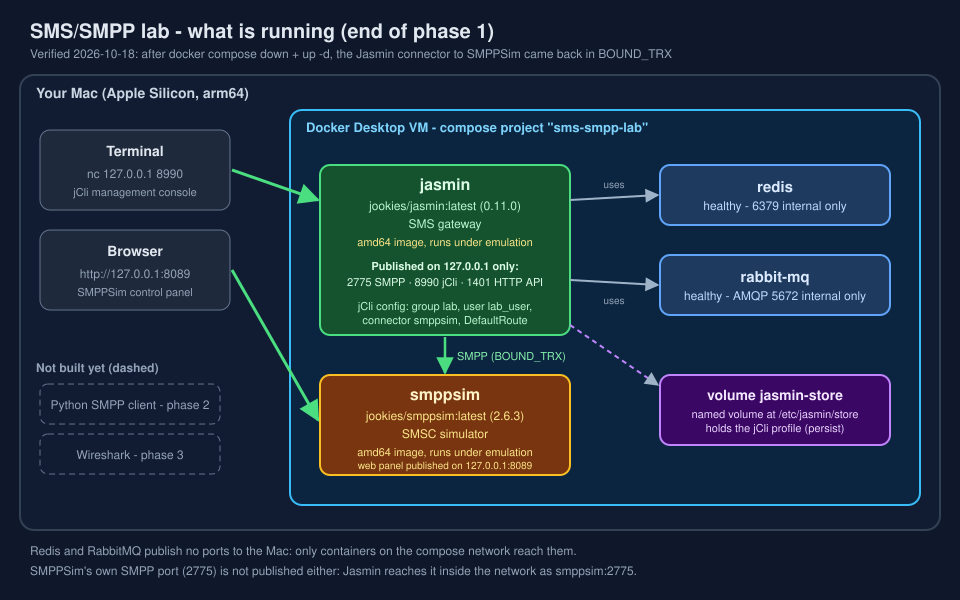

# sms-smpp-lab

A hands-on lab to learn how SMS works end to end, with a focus on SMPP, using Docker on a laptop. It is a personal study project, not production software.

## Status

| Phase | Content | Status |
|---|---|---|
| 1 | Jasmin SMS gateway + SMPPSim (SMSC simulator) in Docker, documented | Done: connector Jasmin to SMPPSim is `BOUND_TRX`, configuration survives `down` + `up -d` |
| 2 | Python SMPP client (bind, submit_sm, delivery receipts, enquire_link, unbind) | Planned |
| 3 | SMPP PDU analysis with Wireshark | Planned |
| 4 | Study of SMS over SS7 MAP, checked against 3GPP | Planned |
| 5 | Small SMS firewall experiment on the SMPP side | Planned |

## What is running (phase 1)

Four containers started by `docker-compose.yml`: Redis, RabbitMQ, Jasmin and SMPPSim. See [docs/compose-explained.md](docs/compose-explained.md).



## Quick start

Requirements: Docker with Compose. Tested only on an Apple Silicon Mac (Docker 29.8.0, Compose v5.5.1). Jasmin and SMPPSim images are amd64 and run under emulation there.

```bash
docker compose up -d
docker compose ps
```

`up -d` creates and starts the containers in the background; `ps` lists them. Then configure Jasmin by following [docs/jasmin-setup.md](docs/jasmin-setup.md) (jCli on `127.0.0.1:8990`) and open the SMPPSim panel at http://127.0.0.1:8089.

Do not run `docker compose down -v`: `-v` also deletes the volume that holds the Jasmin configuration.

## Security note

All published ports are bound to `127.0.0.1` only. The credentials in the docs are defaults of Jasmin and SMPPSim or throwaway lab values. Do not reuse them anywhere else and do not expose these ports to a network.

## Documentation

- [docs/compose-explained.md](docs/compose-explained.md): the Compose file, ports, persistence, start and stop.
- [docs/jasmin-setup.md](docs/jasmin-setup.md): configuring the gateway with jCli.
- [docs/sms-end-to-end.md](docs/sms-end-to-end.md): where SMPP and MAP sit in an SMS path. General description, not yet verified against 3GPP.
- [docs/GLOSSARY.md](docs/GLOSSARY.md): acronyms and terms.

## AI assistance

The documentation and diagrams were drafted with Claude (Anthropic) and checked and run by the author on a local machine. The SVG diagrams were edited after generation, so any content-credentials metadata they originally carried was removed because it no longer matched the files.

## Credits and references

- Jasmin SMS Gateway (jookies/jasmin, Apache License 2.0), version 0.11.0 used here: https://github.com/jookies/jasmin, documentation https://docs.jasminsms.com. This repository only runs the published Docker image `jookies/jasmin`. The Compose file is adapted from the one in the Jasmin repository.
- SMPPSim by Selenium Software, version 2.6.3 used here, licensed under the GPL. This repository does not include or redistribute it: it only runs the Docker image `jookies/smppsim`, which Jasmin's own repository also references as a provided SMPP simulator.
- Docker Compose documentation: https://docs.docker.com/compose and the `docker compose down` reference.
- RabbitMQ: https://www.rabbitmq.com
- Redis: https://redis.io
- 3GPP TS 23.040 (SMS technical realization) and TS 29.002 (MAP): to be consulted in phase 4; nothing in this repository is claimed to be verified against them yet.

## License

Copyright 2026 Jose de Jesus Agustin Gonzalez. Licensed under the Apache License, Version 2.0: see [LICENSE](LICENSE).

`docker-compose.yml` is adapted from the compose file of Jasmin (Copyright 2014-2016 Jookies LTD, also Apache License 2.0). The changes are listed at the top of that file. SMPPSim (GPL) is not part of this repository.
