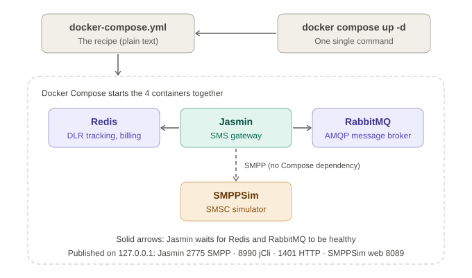

# Docker Compose explained

This page explains `docker-compose.yml`: what each service is for, what is published to your machine, how configuration survives restarts, and how to start and stop the lab safely.

Tested on: Apple Silicon Mac (arm64), Docker Desktop with Docker 29.8.0 and Compose v5.5.1, Jasmin 0.11.0 (image `jookies/jasmin:latest`), SMPPSim 2.6.3 (image `jookies/smppsim:latest`).

## What a Compose file is
A Docker Compose file (`docker-compose.yml`, written in YAML) describes several containers that work together: which image each one uses, which ports it publishes, which environment variables it receives and which service it waits for. Instead of one long `docker run` command per service, you write the setup once and control everything with a few commands.



## The four services

| Service | Image | Role in this lab |
|---|---|---|
| `jasmin` | `jookies/jasmin:latest` | The open source SMS gateway. Accepts SMPP clients, routes messages and exposes a management console. |
| `rabbit-mq` | `rabbitmq:3.10-management-alpine` | The AMQP message broker Jasmin uses for its internal queues. |
| `redis` | `redis:alpine` | Used by Jasmin for in-memory delivery receipt (DLR) tracking and billing. |
| `smppsim` | `jookies/smppsim:latest` | A simulated SMSC (SMS Center). It is the upstream destination Jasmin forwards to, so the lab needs no real operator link. |

The roles of RabbitMQ and Redis come from the feature list in Jasmin's README: "Based on AMQP broker for store&forward mechanisms and other queuing systems" and "Using Redis for in-memory DLR tracking and billing".

**Two different "store and forward".** In Jasmin, "store&forward" means messages wait in queues inside the gateway (on RabbitMQ). That is not the same thing as the store-and-forward behaviour of an SMSC in a mobile network. The documentation keeps them under separate names; for a general (not yet 3GPP-verified) description of how SMS moves through a mobile network, see [sms-end-to-end.md](sms-end-to-end.md).

## Ports and what is published to your machine
Only these ports are published, and all of them are bound to `127.0.0.1` (your own machine, not your network):

| Host address | Container | What it is |
|---|---|---|
| `127.0.0.1:2775` | `jasmin:2775` | SMPP server: where SMPP clients bind. |
| `127.0.0.1:8990` | `jasmin:8990` | jCli, Jasmin's management console (telnet-style, reachable with `nc`). |
| `127.0.0.1:1401` | `jasmin:1401` | Jasmin HTTP API. |
| `127.0.0.1:8089` | `smppsim:89` | SMPPSim web control panel. |

Redis and RabbitMQ publish nothing: only the other containers on the Compose network reach them. SMPPSim's own SMPP port (2775) is also not published; Jasmin reaches it inside the Compose network as `smppsim:2775`.

Jasmin's jCli ships with default credentials (`jcliadmin` / `jclipwd`). They are fine for a throwaway local lab because the port is bound to `127.0.0.1`; do not reuse them anywhere else.

The picture below shows the running lab as verified on 2026-10-18.


## Startup order
Redis and RabbitMQ define health checks, and `jasmin` uses `depends_on` with `condition: service_healthy`, so Jasmin only starts once both report healthy. This is the same approach as the compose file in Jasmin's own repository. `smppsim` has no health check and no dependency.

## Resource limits
Each service has CPU and memory limits (`deploy.resources.limits`). The values for `redis`, `rabbit-mq` and `jasmin` are the ones in Jasmin's own compose file. The `smppsim` limits (1 CPU, 512 MB) are our own choice, not taken from upstream. With all four containers running, Docker Desktop showed about 340-375 MB of total container memory in this lab.

## Persistence: how configuration survives restarts
Jasmin's jCli keeps what you configure (groups, users, connectors, routes) in memory until you run `persist`. `persist` writes the configuration to a profile (`jcli-prod`) in `/etc/jasmin/store` inside the container (the default `store_path` in `jasmin.cfg`), and Jasmin loads that profile when it starts. Connectors that were started when saved are started again on load.

What the image gives you: the `jookies/jasmin` image declares volumes for `/etc/jasmin`, `/etc/jasmin/store` and `/var/log/jasmin` (we confirmed this with `docker inspect`). Those are anonymous volumes: Docker creates a fresh, empty one each time the container is created. So the compose file adds a **named volume** for the part that matters:

```yaml
    volumes:
      - jasmin-store:/etc/jasmin/store
# ...
volumes:
  jasmin-store:
```

We tested the result: after `persist`, then `docker compose down` and `docker compose up -d` (all containers recreated), the connector to SMPPSim came back in `BOUND_TRX` without any manual configuration.

## Starting and stopping the lab safely

| Command | What it does | Configuration kept? |
|---|---|---|
| `docker compose stop` / `docker compose start` | Stops / starts the existing containers without removing them. | Yes |
| `docker compose down` / `docker compose up -d` | `down` removes the containers and the network; `up -d` creates them again. | Yes, because of the named volume (after `persist`) |
| `docker compose down -v` | Same as `down`, plus it removes the named volumes declared in the Compose file and anonymous volumes attached to the containers. | **No: it deletes `jasmin-store`.** Do not use it unless you want to start from zero. |

Stopped containers do not use memory, so `stop` is the simplest way to free resources when you are not using the lab.

**Leftover volumes.** By default `docker compose down` keeps anonymous volumes (per the Docker documentation). After `down` + `up -d`, the anonymous volumes of the removed containers stay behind unused. `stop` / `start` does not create this clutter because it does not recreate containers. To list unused volumes and remove one you are sure about:

```
docker volume ls --filter dangling=true
docker volume rm <volume-name>
```

`docker volume rm` refuses to delete a volume that a container is using.

## Known limitation on Apple Silicon
The published `jookies/jasmin` and `jookies/smppsim` images are `linux/amd64`. On an Apple Silicon (arm64) Mac they run under emulation, and Docker Desktop shows an "AMD64" warning badge next to both containers (its text for Jasmin: "image may have poor performance, or fail, if run via emulation"). The compose file pins `platform: linux/amd64` on both services. Everything in this lab ran under emulation without problems, but it is a learning setup, not a production one.

## Sources
- Jasmin documentation: https://docs.jasminsms.com/en/latest/
- Jasmin repository (README feature list, `docker-compose.yml`, `jasmin.cfg`): https://github.com/jookies/jasmin
- `docker compose down` reference: https://docs.docker.com/reference/cli/docker/compose/down/
- Docker Compose documentation: https://docs.docker.com/compose/
