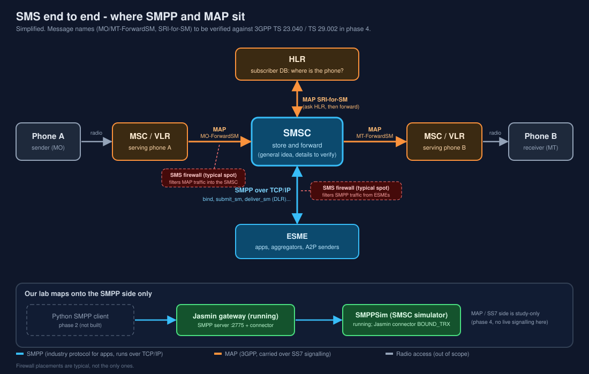

# SMS end to end: where SMPP and MAP sit

> Status: general description, NOT yet verified against the specifications. Flows and message names below come from general telecom knowledge and still have to be checked against 3GPP TS 23.040 and TS 29.002 (planned for phase 4). Nothing here is claimed as verified unless it says so.

## The idea in one paragraph

An SMS does not travel directly from phone to phone. It goes to a server called the **SMSC** (Short Message Service Center), which keeps the message and then delivers it. Two different protocol families appear around the SMSC:

- **MAP** (Mobile Application Part) runs over **SS7** signalling inside the mobile network, between the phones' serving switches, the subscriber database and the SMSC.
- **SMPP** (Short Message Peer-to-Peer) runs over **TCP/IP** between applications (called **ESMEs**, External Short Messaging Entities) and the SMSC.

This lab builds the SMPP side. The MAP side is studied, not built (phase 4).

## Path 1: a phone sends an SMS (MO, Mobile Originated)

1. Phone A sends the message over the radio network to the **MSC/VLR** (Mobile Switching Center / Visitor Location Register) that serves it.
2. The MSC hands the message to the SMSC with the MAP operation commonly called **MO-ForwardSM** (Mobile Originated Forward Short Message).
3. The SMSC accepts and stores it.

## Path 2: the SMSC delivers to a phone (MT, Mobile Terminated)

1. The SMSC asks the **HLR** (Home Location Register, the subscriber database) where the destination phone is, with the MAP operation commonly called **SRI-for-SM** (Send Routing Info for Short Message).
2. The HLR answers with routing information for the serving network.
3. The SMSC sends the message to the serving MSC/VLR with **MT-ForwardSM** (Mobile Terminated Forward Short Message).
4. The MSC delivers it to phone B over the radio network.

If phone B cannot be reached, the SMSC is expected to keep the message and try again later (the classic store-and-forward behaviour of an SMSC). The exact retry and expiry rules are NOT described here because they are not verified yet. This is different from the "store&forward" queues inside Jasmin, which live on RabbitMQ in the gateway.

## Path 3: an application sends an SMS (SMPP) - the A2P path

An ESME (a company app, an aggregator, a bulk sender) opens a TCP connection to the SMSC and speaks SMPP: it **binds** (logs in), sends **submit_sm** (submit a short message), and later may receive **deliver_sm** (for example a delivery receipt, DLR). Common name for this traffic: A2P (Application-to-Person).

In the diagram this is the yellow-highlighted route: ESME to SMSC over SMPP, then the same delivery steps as path 2 (SRI-for-SM, then MT-ForwardSM) to the phone. A delivery receipt can flow back to the ESME. This is the part the lab builds.

## Where an SMS firewall typically sits

Typical placements (not the only ones): on the MAP side, filtering traffic that reaches the SMSC from other networks, and on the SMPP side, filtering what ESMEs submit. Phase 5 builds a small experiment on the SMPP side.

## What the lab covers

| Piece | Status |
|---|---|
| Jasmin gateway (SMPP server on port 2775) | Running, configured (phase 1), see [jasmin-setup.md](jasmin-setup.md) |
| Python SMPP client | Phase 2 |
| Upstream SMSC (simulator) | SMPPSim, running; the Jasmin connector is `BOUND_TRX` (phase 1) |
| MAP / SS7 side | Study only (phase 4) |

## Sources

- 3GPP TS 23.040 (SMS technical realization) and TS 29.002 (MAP): to consult in phase 4 to verify this page.
- Jasmin documentation: https://docs.jasminsms.com
- SMPPSim, the SMSC simulator used here: credited in the README.
